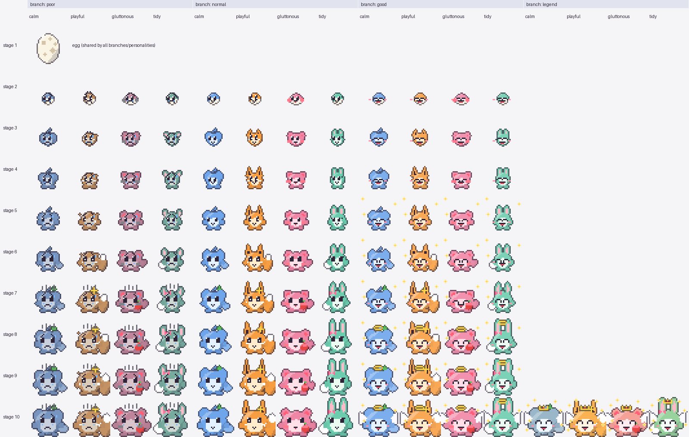

# PokkePet（ポッケペット）

macOS のメニューバーに住む、ドット絵の育成ゲームです。卵から始まり、世話をしながら 10 段階で育てます。
ウィンドウを開きっぱなしにする必要はありません。メニューバーのアイコンをクリックすると小さなポップアップが開き、閉じている間もバックグラウンドで時間が進みます。



- 対象: **macOS（Apple Silicon / `aarch64-apple-darwin` 専用）**
- 技術: Tauri v2 ・ Rust ・ TypeScript ・ React ・ Vite
- バージョン: 0.5.0

---

## 目次

1. [特長](#1-特長)
2. [インストール（アプリを使うだけの人向け）](#2-インストールアプリを使うだけの人向け)
3. [遊び方](#3-遊び方)
4. [開発環境の構築](#4-開発環境の構築)
5. [開発用コマンド](#5-開発用コマンド)
6. [テストとカバレッジ・CI](#6-テストとカバレッジci)
7. [ビルドと配布](#7-ビルドと配布)
8. [プロジェクト構成と設計方針](#8-プロジェクト構成と設計方針)
9. [データの保存先とリセット](#9-データの保存先とリセット)
10. [素材（ドット絵・アイコン）の再生成](#10-素材ドット絵アイコンの再生成)
11. [開発の進め方（TDD・GitHub Flow）](#11-開発の進め方tddgithub-flow)
12. [トラブルシューティング](#12-トラブルシューティング)
13. [関連ドキュメント](#13-関連ドキュメント)

---

## 1. 特長

- **メニューバー常駐**: Dock には出ません。アイコンの横の絵文字（🍙・💤 など）で、開かなくても状態がわかります。
- **育成**: ご飯・おやつ・遊ぶ・掃除の 4 つのお世話。放置すると機嫌が悪くなり、育て方で姿が変わります。
- **109 種のキャラクター**: 成長段階 9 × 分岐 3 × 性格（種族）4 ＋ 卵。図鑑で集められます。
- **約 5 日かけて育つ**: 卵が届いてから旅立ちの時まで約 4 日 21 時間（実時間。アプリを閉じていても進みます）。
- **おやすみ時間**: 夜はキャラも眠り、状態の減りがゆっくりになります（時間帯は設定で変えられます）。
- **世代交代**: 旅立ちを見送ると次の卵が届き、図鑑と思い出は引き継がれます。
- **鳴き声**: 種族ごとに声が違い、お世話やしぐさに合わせて鳴きます（設定でオフにできます）。
- **通知**: 孵化・旅立ち・お世話の呼びかけを macOS の通知で知らせます（オフにもできます）。
- **ミニゲーム、図鑑、思い出（日記）、配色設定**つき。

---

## 2. インストール（アプリを使うだけの人向け）

> ビルド済みの配布物（`.dmg`）は、このリポジトリでは配布していません。自分でビルドする方法は [7. ビルドと配布](#7-ビルドと配布) を参照してください。

### 2.1 dmg からインストールする

1. `PokkePet_0.5.0_aarch64.dmg` を開きます。
2. 表示された **PokkePet.app** を **アプリケーション**フォルダへドラッグします。
3. アプリケーションフォルダの PokkePet を起動します。Dock には出ず、**メニューバーの右側にきつねのアイコン**が現れます。

### 2.2 初回起動時の注意

このアプリは **署名・公証をしていません**。初回は macOS の Gatekeeper に止められることがあります。

- 「開発元を検証できません」と出たら、アプリを **右クリック（または control+クリック）→ 開く** を選び、確認ダイアログで「開く」を押します。
- それでも開けない場合は、ターミナルで隔離属性を外します。

```bash
xattr -dr com.apple.quarantine /Applications/PokkePet.app
```

### 2.3 通知の許可

孵化・旅立ち・お世話の呼びかけは macOS の通知で届きます。初回に「通知を許可しますか？」と聞かれたら **許可** してください（許可しなくても、ゲームは問題なく遊べます）。
あとから変えるには「システム設定 → 通知 → PokkePet」で設定します。

### 2.4 終了とアンインストール

- 終了: メニューバーのアイコンを **右クリック → 「終了」**。
- アンインストール: アプリケーションフォルダの PokkePet.app をゴミ箱へ。セーブデータも消す場合は [9. データの保存先とリセット](#9-データの保存先とリセット) を参照してください。

---

## 3. 遊び方

### 3.1 基本の操作

| 操作 | 動作 |
|---|---|
| メニューバーのアイコンを **左クリック** | ポップアップを開く／閉じる |
| メニューバーのアイコンを **右クリック** | メニュー（図鑑…／思い出…／設定…／終了） |
| ポップアップの外をクリック | ポップアップが自動で閉じる |

ポップアップは **画面（キャラが住む部分）** と **ボタン（お世話をする部分）** に分かれています。

### 3.2 お世話のボタン

ポップアップ下部に 4 つの丸いボタンがあります。

| ボタン | 効果 |
|---|---|
| 🍙 **ご飯** | 空腹度が大きく回復し（+40）、ご機嫌と親密度が少し上がります |
| 🍪 **おやつ** | ご機嫌が大きく上がります（+15）。ただし **おなかがいっぱい（空腹度 80 以上）のときにあげると食べすぎ** になり、ご機嫌が下がります（−10） |
| 🎾 **遊ぶ** | ミニゲーム「どっちの手？」が始まります（孵化後）。遊ぶとご機嫌と親密度が上がり、空腹度が少し減ります |
| 🤚 **撫でる** | 卵の間だけ、「遊ぶ」が「撫でる」になります。ご機嫌と親密度が少し上がります（空腹度は減りません） |
| 🧹 **掃除** | 部屋の汚れをリセットします |

> 新しく始めたペットは満腹気味（空腹度 80）です。最初のおやつは食べすぎになるので、少しおなかがすいてからあげるのがコツです。

### 3.3 キャラの状態の見かた（数字ではなく見た目で）

数値のゲージは既定では出しません。状態は背景・吹き出し・動きでわかります。

| 見た目 | 意味 |
|---|---|
| 背景が明るい暖色 | ご機嫌が高い |
| 背景がくすんだ灰青 | ご機嫌が低い |
| 背景にほこりの斑点 | 部屋が汚れている（増えるほど汚い） |
| キャラがしょんぼり揺れる | おなかがすいている |
| 吹き出し「おなかすいたよ…」 | 空腹（最優先） |
| 吹き出し「おへや、よごれてるよ…」 | 部屋が汚れている |
| 吹き出し「つまんないな…」 | ご機嫌が低い |
| 吹き出し「たのしい！」 | ご機嫌が高く、困りごとがない |
| 画面が暗く「Zzz…」 | おやすみ中 |

**メニューバーの目印**（アイコンの横の絵文字）:

| 目印 | 意味 |
|---|---|
| 🥚 | 卵が届いたところ（まだ何も世話していない） |
| 🐣 | 卵が孵った（まだ孵化を見ていない） |
| 🍙 | おなかがすいている |
| 🧹 | 部屋が汚れている |
| 💧 | つまんない（機嫌が低い） |
| 💤 | おやすみ中 |
| 👋 | 旅立ちの時がきた |
| （なし） | 特に困りごとなし |

**数値ゲージを見たいとき**は、隠しコマンドで表示できます。ポップアップを開いた状態で、キーボードの **↑ ↑ ↓ ↓** を順に押します（もう一度押すと隠れます。設定ダイアログの「ゲージを表示」と同じ設定です）。

### 3.4 ゲームの流れ

#### ① 卵が届く（オープニング）
初めて起動すると、卵がふわっと現れ、「卵が届いたよ！撫でてあげてね」と吹き出しが出ます。**撫でる**と卵が揺れます。

#### ② 孵化
卵が届いてから **約 10 分** で孵化します。ポップアップを開いていると、卵が揺れ、画面がフラッシュして、キャラが飛び出す演出が見られます。閉じている間に孵化した場合は、通知が届き、次に開いたときに演出が再生されます。

#### ③ 名前をつける
孵化の演出のあと、「名前をつけてあげてね」と出ます。1〜8 文字で名前を付けられます（「あとで」で閉じても、あとから設定ダイアログで付けられます）。名前を付けると、吹き出しが「ごま「おなかすいたよ…」」のように名前入りになります。

#### ④ 成長・進化
一定時間ごとに次の段階へ進化します。進化の間隔は、序盤は早く、育つほど長くなります。

| 段階 | 次の段階までの長さ |
|---|---|
| 卵 | 10 分 |
| 2〜4 | 各 3 時間 |
| 5〜7 | 各 12 時間 |
| 8〜9 | 各 24 時間 |
| 10（最終段階） | 24 時間 → 旅立ちの時 |

卵が届いてから旅立ちの時までは **約 4 日 21 時間** です。時間は **実時間**で進み、アプリを閉じている間やスリープ中も止まりません。

**段階の数字は画面に出ません。段階はキャラのデザイン（大きさ・耳・足・しっぽ・小物）で見分けます。**

#### ⑤ 姿が決まるしくみ（分岐と性格）

進化のたびに、次の 2 つで姿が決まります。

**分岐（機嫌と親密度の平均）**

| 分岐 | 条件 | 見た目 |
|---|---|---|
| しょんぼり（poor） | 平均 40 以下 | 色がくすむ・困り顔・汗 |
| ふつう（normal） | 41〜69 | 標準色・平常顔 |
| きらきら（good） | 70 以上 | にっこり顔・ほっぺ・きらめき・天使の輪・羽 |

**性格（種族）— これまでの行動で最も多かったもの**

| 性格 | きっかけ | 種族 |
|---|---|---|
| ぽっちゃり | 「ご飯」と「おやつ」の合計が最多 | ぽっちゃり（ピンク） |
| きつね | 「遊ぶ」が最多 | きつね（オレンジ） |
| うさぎ | 「掃除」が最多 | うさぎ（ミント） |
| ふわもち | 同数・まだ何もしていない | ふわもち（青） |

> 卵を撫でる回数は性格に数えません。何もしなければ前の世代の性格を受け継ぎます（世代交代を参照）。

#### ⑥ 旅立ち（世代交代）
最終段階（段階 10）になって 24 時間たつと **旅立ちの時** を迎えます。通知が届き、ポップアップを開くと「旅立ちの時がきたよ」が出ます。

- **見送る**: 次の世代の卵が届きます。**図鑑と思い出は引き継ぎ**ます。次のペットは、何もしなければ前の世代の性格に育ちます。
- **もう少しいっしょにいる**: その世代の間だけお別れ画面を隠します。自動では旅立たないので、いつでも見送れます。

### 3.5 ミニゲーム「どっちの手？」

孵化後に **遊ぶ** を押すと、画面にミニゲームが開きます。ペットがおやつを隠した手を **左／右** から当てます。

- **当たり**: 通常の「遊ぶ」の効果に加えて、ご機嫌 +10・親密度 +3 のボーナス。
- **外れ**: 通常の「遊ぶ」の効果は入ります（ペナルティはありません）。
- 結果のあと、「もういちど」で続けて遊べます。

### 3.6 夜と留守番

- **おやすみ時間**（既定 23:00〜翌 7:00）は、キャラが眠り、ご機嫌・空腹・汚れの変化が **1/4** になります。画面が暗くなり「Zzz…」と出ます。
- **留守番**: 前回から 5 分以上空いた（アプリを閉じていた・Mac がスリープしていた）ときも、その間の変化が **1/4** になります。おやすみ時間と重なると 1/16 です。
- 成長（進化の時間）は、おやすみや留守番でも **遅くなりません**。

### 3.7 鳴き声

ポップアップを開いている間、キャラが鳴きます。**種族ごとに声が違い**（きつねは高く、ぽっちゃりは低い）、**大きく育つほど声が低く**なります。卵は「コツコツ」と音を立てます。

| 場面 | 鳴き声 |
|---|---|
| ポップアップを開いたとき | ご機嫌が高いと嬉しそうに、低い・おなかがすいていると寂しそうに鳴く |
| ご飯・おやつ | もぐもぐ |
| 掃除 | ふつうの声 |
| ミニゲーム | 当たりは嬉しそうに、外れは残念そうに |
| 孵化の演出 | 卵のコツコツ → 生まれた瞬間の声 |
| しぐさ | ときどき（はねる・踊るは嬉しそうに、ため息は寂しそうに） |

- おやすみ中は鳴きません。音量は小さめです。
- **オフにする**: 設定ダイアログの「サウンド > 鳴き声を鳴らす」。
- 音はポップアップの画面が鳴らすため、閉じている間は鳴きません（閉じている間のお知らせは、通知で届きます）。
- 最初のクリックやキー入力の前は、あいさつの声が鳴らないことがあります（macOS の WebView の仕様）。

### 3.8 通知

| 通知 | いつ |
|---|---|
| 孵化 | ポップアップが閉じている間に卵が孵ったとき |
| 旅立ち | ポップアップが閉じている間に旅立ちの時を迎えたとき |
| お世話の呼びかけ | おなかがすいた／部屋が汚れた／つまらない、のとき |

お世話の呼びかけは、しつこくならないように次のルールがあります。

- 困りごとが始まったらすぐ通知。同じ種類は **1 時間** あけて再通知します。
- 世話をしないまま **3 回** 通知したら、次にお世話するまで黙ります（お世話するとリセット）。
- **おやすみ中・ポップアップを開いている間・設定でオフにしているとき** は通知しません。

### 3.9 右クリックメニューの機能

メニューバーのアイコンを右クリックすると開けます。

#### 図鑑
出会った姿の一覧です。全 **109 種**（卵 1 ＋ 段階 2〜10 × 分岐 3 × 性格 4）を、段階ごとの行に並べます。**未発見の姿は黒いシルエット**で表示され、名前は伏せられます。上部に「発見 N / 109」と進捗バーが出て、全部集めると「コンプリート！」です。進化するたびに自動で更新されます。

#### 思い出
これまでの出来事を新しい順に記録します。「いっしょに N 日目」も表示します。記録される出来事は次のとおりです。

- 卵が届いた／卵が孵った
- 進化した（段階・分岐・種族つき）
- 名前を付けた（付け直しも）
- お世話の回数が節目（10・50・100・250・500・1000 回）
- 旅立ちを見送った

#### 設定
変更はすぐ保存されて反映されます。

| 項目 | 内容 |
|---|---|
| ペット > 名前 | 名前の付け直し（1〜8 文字） |
| 表示 > ゲージを表示 | 数値ゲージの表示／非表示（隠しコマンドと同じ） |
| おやすみ時間 | 開始・終了の時刻（0〜23 時）。同じ時刻にすると「おやすみなし」 |
| サウンド > 鳴き声を鳴らす | 鳴き声のオン／オフ（既定はオン） |
| 通知 > お世話の呼びかけを通知 | 呼びかけ通知のオン／オフ（既定はオン） |
| 配色 | 本体の色・ボタンの色。プリセット（ブルー／ミント／サンセット／グレープ／モノクロ）とカラーピッカー |
| 初期設定に戻す | 設定をすべて初期値へ |

---

## 4. 開発環境の構築

### 4.1 前提

| ツール | バージョン | 用途 |
|---|---|---|
| macOS（Apple Silicon） | 13 以降を推奨 | 実行・ビルド対象（Intel Mac は対象外） |
| Xcode Command Line Tools | 最新 | Rust/Tauri のビルド |
| Node.js | v20 以上（動作確認: v25） | フロントエンド |
| pnpm | 動作確認: 12.14 | パッケージ管理 |
| Rust | 1.85 以上（edition 2024。動作確認: 1.96） | バックエンド |
| Python 3 + Pillow | 任意 | ドット絵・アイコンの生成（[10. 素材](#10-素材ドット絵アイコンの再生成)） |

### 4.2 セットアップ手順

```bash
# 1. Xcode Command Line Tools（未インストールの場合）
xcode-select --install

# 2. Node.js（例: Homebrew）と pnpm
brew install node
npm install -g pnpm

# 3. Rust（rustup）と Apple Silicon 用ターゲット
curl --proto '=https' --tlsv1.2 -sSf https://sh.rustup.rs | sh
rustup target add aarch64-apple-darwin

# 4. リポジトリを取得して依存関係をインストール
git clone https://github.com/Toshiaki0315/PokkePet.git
cd PokkePet
pnpm install
```

### 4.3 テスト用ツール（任意・テストを動かすなら必須）

```bash
# Rust のカバレッジ計測
cargo install cargo-tarpaulin
```

TypeScript 側（`vitest`・`@vitest/coverage-v8`・Testing Library）は `pnpm install` で入ります。

### 4.4 動作確認

```bash
make dev
```

初回は Rust の依存関係をビルドするため数分かかります。起動するとメニューバーにアイコンが現れます。

---

## 5. 開発用コマンド

### 5.1 make（よく使うもの）

| コマンド | 内容 |
|---|---|
| `make dev` | 開発モードで起動（ホットリロード）。保存先は開発用の `dev/`（[9](#9-データの保存先とリセット)） |
| `make dev TIME_SCALE=240` | 経過時間を 240 倍にして起動（動作確認用） |
| `make app` | リリースビルドして `PokkePet.app` を作る |
| `make dmg` | リリースビルドして `.dmg` を作る |

**時間を速めて確認するとき（`TIME_SCALE`）**

| 指定 | 目安 |
|---|---|
| `TIME_SCALE=240` | 1 秒 ≒ 4 分。卵が約 2.5 秒で孵化、3 時間の段階が約 45 秒 |
| `TIME_SCALE=480` | 旅立ちの時まで約 15 分 |

**夜の表示を確認するとき**は、タイムゾーンを変えて起動すると、昼間でも夜の表示を確認できます。

```bash
TZ=Etc/GMT-4 make dev
```

### 5.2 pnpm / cargo

| コマンド | 内容 |
|---|---|
| `pnpm dev` | Vite の開発サーバーのみ（通常は `make dev` を使う） |
| `pnpm build` | TypeScript の型チェック + フロントエンドのビルド |
| `pnpm test` | フロントエンドのテスト（vitest） |
| `pnpm test:coverage` | フロントエンドのテスト + カバレッジ（90% 未満で失敗） |
| `pnpm exec tsc --noEmit` | 型チェックのみ |
| `cd src-tauri && cargo test --lib` | バックエンドのテスト |
| `cd src-tauri && cargo tarpaulin --lib --fail-under 90` | バックエンドのカバレッジ（90% 未満で失敗） |
| `cd src-tauri && cargo check` | コンパイル確認 |

---

## 6. テストとカバレッジ・CI

### 6.1 方針

- **TDD（Red → Green → Refactor）**を守ります。実装の前に、失敗するテストを書きます。
- **カバレッジ目標は 90% 以上**（バックエンド・フロントエンドともに）。現在は両方とも 100% です。
- ゲームのロジック（パラメータ計算・進化・時間経過・乱数・通知の判断など）は **すべて Rust 側**に置き、Rust 側でテストします。

### 6.2 バックエンド（Rust）

```bash
cd src-tauri
cargo test --lib
cargo tarpaulin --lib --fail-under 90
```

- Tauri との接着コード（`lib.rs`・`main.rs`・`shell.rs`）は、ロジックを持たない薄い層なので、`src-tauri/tarpaulin.toml` でカバレッジの対象外にしています。
- ゲームバランス（放置は「しょんぼり」、数時間おきは「ふつう」、毎時間以上は「きらきら」）は、**卵が届いてから旅立ちまでの全期間を 1 分刻みでシミュレーション**するテストで固定しています。

### 6.3 フロントエンド（TypeScript）

```bash
pnpm test              # テストのみ
pnpm test:coverage     # カバレッジ付き（90% 未満で失敗）
```

- テストは `src/*.test.ts(x)`、環境は jsdom、Tauri との通信（`invoke` / `listen`）はモックします。
- ドット絵が全 109 枚そろっていて 32×32 であることも、テストで確認しています。

### 6.4 CI（GitHub Actions）

`.github/workflows/ci.yml` で、Pull Request と main への push のたびに次を実行します。

| ジョブ | 内容 |
|---|---|
| `Frontend (vitest, coverage >= 90%)` | 型チェック + フロントエンドのテスト（カバレッジ 90% 以上） |
| `Backend (cargo test, coverage >= 90%)` | Rust のテスト + カバレッジ 90% 以上 |

main ブランチはブランチ保護（Ruleset）で、**この 2 ジョブの成功が必須**です。直接 push はできず、Pull Request 経由でマージします（[11. 開発の進め方](#11-開発の進め方tddgithub-flow)）。

---

## 7. ビルドと配布

### 7.1 ビルドのしかた

```bash
make app     # PokkePet.app を作る
make dmg     # .dmg を作る
```

内部では、依存関係のインストール（`pnpm install --frozen-lockfile`）のあと、`pnpm tauri build --target aarch64-apple-darwin --bundles app`（または `dmg`）を実行しています。初回の Rust のリリースビルドは数分かかります。

### 7.2 成果物の場所

```
src-tauri/target/aarch64-apple-darwin/release/bundle/
├── macos/PokkePet.app              # make app / make dmg
└── dmg/PokkePet_0.5.0_aarch64.dmg  # make dmg
```

> `make dmg` のとき、`.app` は dmg の作成中に整理されて残らないことがあります。両方ほしいときは `make dmg` のあとに `make app` を実行してください。

### 7.3 バージョンを上げるとき

次の 4 か所を同じ値に更新します。

| ファイル | 場所 |
|---|---|
| `package.json` | `"version"` |
| `src-tauri/Cargo.toml` | `version` |
| `src-tauri/Cargo.lock` | `pokkepet` の `version`（`cargo check` で自動更新） |
| `src-tauri/tauri.conf.json` | `"version"` |

### 7.4 署名・公証について

署名（Developer ID）と公証（notarization）は **未対応**です。他の Mac に配るときは、受け取った人が Gatekeeper の確認（[2.2](#22-初回起動時の注意)）を行う必要があります。一般公開するなら、Apple Developer Program への登録と、署名・公証の設定が必要です。

> 透過ウィンドウのために macOS のプライベート API（`macOSPrivateApi`）を有効にしています。そのため、**Mac App Store では配布できません**。`.dmg` での配布は問題ありません。

---

## 8. プロジェクト構成と設計方針

### 8.1 ディレクトリ構成

```
PokkePet/
├── README.md                         このファイル
├── 01_requirement_definition.md      要件定義（実装済みの仕様をまとめたもの）
├── 02_architecture_and_tech_stack.md アーキテクチャ・技術スタック
├── 03_environment_setup.md           環境構築メモ（初期の設計書）
├── 04_development_process_and_tdd.md 開発プロセス・TDD・コーディング規約
├── 05_character_design_catalog.md    キャラクターデザイン一覧
├── Makefile                          make dev / app / dmg
├── docs/character_catalog.png        キャラクター一覧画像
├── tools/
│   ├── gen_sprites.py                ドット絵（109 枚）と一覧画像の生成
│   └── gen_icon.py                   アプリアイコンの生成
├── public/sprites/                   ドット絵（32×32 PNG、109 枚）
├── src/                              フロントエンド（React / TypeScript）
│   ├── App.tsx                       ポップアップ（画面とボタン）
│   ├── Settings.tsx                  設定ダイアログ
│   ├── Dex.tsx                       図鑑
│   ├── Diary.tsx                     思い出
│   ├── MiniGame.tsx / Farewell.tsx / NamePrompt.tsx   画面内のダイアログ
│   ├── hatch.tsx / idle.ts           孵化の演出・待機中のしぐさ
│   ├── api.ts                        Rust とのやり取り（invoke / listen）の薄いラッパ
│   └── *.test.ts(x)                  テスト
└── src-tauri/                        バックエンド（Rust / Tauri v2）
    ├── tauri.conf.json               ウィンドウ・バンドルの設定
    ├── capabilities/default.json     ウィンドウごとの権限
    ├── icons/                        アプリアイコン
    └── src/
        ├── status.rs                 ステータスとお世話の効果
        ├── evolution.rs              成長の長さ・進化・性格・分岐
        ├── game.rs                   ゲーム全体の状態・時間経過・セーブ/ロード
        ├── service.rs                画面へ渡す値（StateView）と排他制御・永続化
        ├── expression.rs             背景・吹き出しなど「見た目の表現」の判断
        ├── sleep.rs                  おやすみ時間
        ├── calls.rs                  呼びかけ通知の判断
        ├── dex.rs / diary.rs         図鑑・思い出
        ├── minigame.rs               ミニゲームの判定と乱数
        ├── settings.rs               ユーザー設定の保存と検証
        ├── paths.rs                  保存先の決め方
        ├── shell.rs                  Tauri との接着（トレイ・ウィンドウ・IPC・通知）
        └── lib.rs / main.rs          エントリポイント
```

### 8.2 設計方針

- **ビジネスロジックは Rust に集約**します。フロントエンドは表示と入力だけで、パラメータ計算・進化判定・時間経過・乱数・通知の判断は持ちません。
- **IPC（Tauri のコマンドとイベント）** で通信します。主なコマンド: `get_state` / `perform_action` / `play_minigame` / `ack_hatch` / `set_name` / `graduate` / `get_settings` / `save_settings` / `get_dex` / `get_diary`。主なイベント: `state-changed`（状態の更新）/ `settings-changed` / `popup-visibility`（ポップアップの開閉）。
- **ゲームループ**は Rust のバックグラウンドスレッドで、10 秒ごとに時間を進め、セーブし、画面へ通知します。
- **セーブ**は JSON ファイルです。書き込みの途中で壊れないよう、一時ファイルに書いてから置き換えます。
- 1 つのフロントエンドを、**ウィンドウのラベル**で画面を切り替えて使います（ポップアップ / `settings` / `dex` / `diary`）。
- コーディング規約: ネストは浅く（早期リターン）、責務を分ける。詳細は [04_development_process_and_tdd.md](04_development_process_and_tdd.md)。

---

## 9. データの保存先とリセット

### 9.1 保存先

| 版 | フォルダ |
|---|---|
| **インストールしたアプリ**（リリース版） | `~/Library/Application Support/com.toshiaki.pokkepet/` |
| **開発版**（`make dev`） | `~/Library/Application Support/com.toshiaki.pokkepet/dev/` |

開発版とリリース版でデータが混ざらないように、フォルダを分けています。

| ファイル | 内容 |
|---|---|
| `save.json` | ゲームのセーブ（状態・成長・履歴・名前・図鑑・思い出・世代など） |
| `settings.json` | 設定（配色・ゲージ表示・おやすみ時間・通知） |

### 9.2 最初からやり直す（卵から始める）

**アプリを終了してから**、セーブを削除します（動いたままだと、10 秒おきに書き戻されます）。

```bash
# インストールしたアプリ
rm ~/Library/Application\ Support/com.toshiaki.pokkepet/save.json

# 開発版
rm ~/Library/Application\ Support/com.toshiaki.pokkepet/dev/save.json
```

設定（配色など）も初期化したいときは、`settings.json` も削除します（または設定ダイアログの「初期設定に戻す」）。

> 古いセーブが読み込めないほど壊れている場合は、エラーを表示して起動しないのではなく、新しい卵から始まります。

---

## 10. 素材（ドット絵・アイコン）の再生成

ドット絵とアイコンは、Python スクリプトで生成した **仮の素材**です。本番の絵に差し替えるときは、同じファイル名で置き換えるだけで、コードを変えずに反映されます。

```bash
pip install pillow    # 初回のみ
```

### 10.1 ドット絵

```bash
python3 tools/gen_sprites.py public/sprites --catalog docs/character_catalog.png
```

- 出力: `public/sprites/` に 32×32 の PNG を 109 枚（`egg.png` と `{段階}-{分岐}-{性格}.png`）。`--catalog` で一覧画像も作ります。
- ファイル名の規則は `src/sprite.ts` の `spritePath()` と対応します。
- デザインのルールは [05_character_design_catalog.md](05_character_design_catalog.md) を参照してください。

### 10.2 アプリアイコン

```bash
python3 tools/gen_icon.py /tmp/app_icon.png playful   # 1024x1024 の元画像を作る
pnpm tauri icon /tmp/app_icon.png                     # 各サイズ（.icns / .ico / PNG）を src-tauri/icons に作る
```

`pnpm tauri icon` は iOS / Android 用のフォルダも作るので、macOS 専用のこのアプリでは `src-tauri/icons/ios` と `src-tauri/icons/android` を削除してください。

---

## 11. 開発の進め方（TDD・GitHub Flow）

### 11.1 流れ

1. **テストを先に書きます**（Red）。失敗することを確認します。
2. **最小の実装で通します**（Green）。
3. **整理します**（Refactor）。カバレッジが 90% を下回らないようにします。
4. 画面や動きに関わる変更は、`make dev`（必要なら `TIME_SCALE`）で **実際に動かして確認**します。
5. 仕様を変えたら、[01_requirement_definition.md](01_requirement_definition.md) も更新します。

### 11.2 ブランチと Pull Request（GitHub Flow）

main ブランチは保護されていて、**直接 push できません**。次の流れで進めます。

```bash
git checkout -b feature/やること          # main から作業ブランチを作る
# ...テストを書く → 実装 → コミット...
git push -u origin feature/やること
gh pr create                              # Pull Request を作る（GitHub の画面からでも可）
```

CI の 2 ジョブ（Frontend / Backend）が成功すると、マージできます。

- コミットメッセージは `feat: ...` / `fix: ...` / `docs: ...` / `chore: ...` のように、種類を頭に付けます。
- 1 つの Pull Request には 1 つの目的だけを入れます。

---

## 12. トラブルシューティング

| 症状 | 原因と対処 |
|---|---|
| 「開発元を検証できません」で開けない | 署名していないためです。[2.2](#22-初回起動時の注意) の手順で開きます |
| メニューバーにアイコンが見当たらない | メニューバーが混み合うと隠れることがあります。他のアイコンを整理するか、メニューバーの `«` を確認してください |
| インストールしたアプリが、いきなり育った姿で始まる | 以前の開発版のセーブが残っています。アプリを終了して `save.json` を削除します（[9.2](#92-最初からやり直す卵から始める)） |
| 通知が来ない | 「システム設定 → 通知 → PokkePet」で許可されているか、設定ダイアログの「お世話の呼びかけを通知」がオンか確認します。ポップアップを開いている間や、おやすみ時間中は通知しません |
| 開発版の通知が「ターミナル」名義になる | 開発版は、起動したターミナルの名義で通知が出ます。ビルドした `.app` は PokkePet の名義になります |
| 日本語入力で名前が決定できない | 変換中の Enter は変換の確定になります。もう一度 Enter（または「決定」ボタン）で決定します |
| `make dev` が `port 1420 is already in use` で失敗する | 前回の開発サーバーが残っています。`lsof -i :1420` で見つけて終了します |
| `cargo` が見つからない | `source "$HOME/.cargo/env"` を実行するか、ターミナルを開き直します |
| Rust のビルドエラー（edition 2024） | Rust が古い可能性があります。`rustup update` で更新します |
| `pnpm install --frozen-lockfile` が失敗する | `pnpm-lock.yaml` と `package.json` が食い違っています。`pnpm install` でロックファイルを更新します |
| ポップアップが開かない | メニューバーのアイコンを **左クリック**します（右クリックはメニュー）。開いたあと外をクリックすると自動で閉じます |
| 鳴き声が聞こえない | 設定ダイアログの「鳴き声を鳴らす」がオンか、Mac の音量・出力先を確認します。ポップアップが閉じている間・おやすみ中は鳴きません。最初のクリックの前は鳴らないことがあります |
| 画面の動きを止めたい | macOS の「アクセシビリティ → ディスプレイ → 視差効果を減らす」をオンにすると、アニメーションを止めます |

---

## 13. 関連ドキュメント

| ファイル | 内容 |
|---|---|
| [01_requirement_definition.md](01_requirement_definition.md) | 要件定義。実装済みの仕様（ゲームのルール・数値・画面）をまとめています |
| [02_architecture_and_tech_stack.md](02_architecture_and_tech_stack.md) | アーキテクチャと技術スタック、役割分担 |
| [03_environment_setup.md](03_environment_setup.md) | 環境構築（初期の設計メモ） |
| [04_development_process_and_tdd.md](04_development_process_and_tdd.md) | 開発プロセス、TDD、カバレッジ目標、コーディング規約 |
| [05_character_design_catalog.md](05_character_design_catalog.md) | キャラクターデザイン一覧（109 種のルール） |
